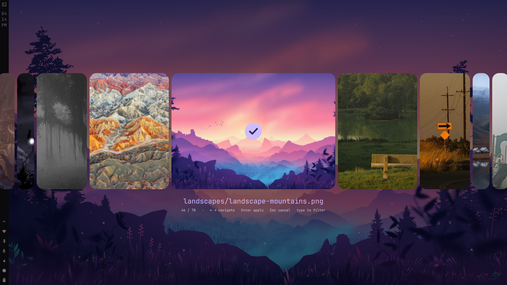

# m3e-wallpaper-picker

> a wallpaper picker nobody asked for, but it's smooth

a keyboard-first wallpaper carousel for [quickshell](https://quickshell.org/) on X11 and Wayland. scroll through your wallpapers, type to filter, hit enter, done.

the m3e is for material 3 expressive: with matugen it re-colors itself from your wallpaper.



---

## this is a modification

this is a modified version of [magetsu002/qs-wallpaper-picker](https://github.com/magetsu002/qs-wallpaper-picker). go star theirs, it does way more than mine (video wallpapers, wallhaven search, color filters, etc).

that project's carousel look comes from [ilyamiro's nixos config](https://github.com/ilyamiro/nixos-configuration), so credit goes there too.

---

## what is this

- a smooth carousel for your wallpapers, local images only
- type to filter by filename
- thumbnails are cached, so it opens fast
- works on both X11 and Wayland
- works with `feh`, `nitrogen`, `xwallpaper`, `hsetroot`, `awww`, `swww`, `hyprpaper`, `swaybg`, or your own command
- matugen or pywal theming, and the picker can match your wallpaper too
- `--restore` for login and `--random` for when you can't decide
- `--doctor` tells you what's missing

---

## install

```bash
git clone https://github.com/twixxty/m3e-wallpaper-picker.git
cd m3e-wallpaper-picker
./install.sh
```

installs to `~/.local` and makes a config at `~/.config/qs-bgselector/config`. then:

```bash
qs-bgselector --doctor   # checks what you're missing
qs-bgselector            # opens the picker
```

if it says `command not found`, `~/.local/bin` isn't in your PATH. on fish that's `fish_add_path ~/.local/bin`.

other ways to install:

| command | what it does |
| --- | --- |
| `./install.sh --prefix /usr` (as root) | system-wide |
| `./install.sh --dev` | symlinks to this folder, for hacking on it |
| `./install.sh --no-config` | skips creating the config |
| `./uninstall.sh [--purge]` | removes it (`--purge` also deletes config + cache) |

you can also just run `./bin/qs-bgselector` straight from the clone without installing.

---

## what you need

**required**

- an X11 window manager (i3, bspwm, openbox, awesome, etc.) or a Wayland compositor
- [quickshell](https://quickshell.org/) (needs the `Quickshell.Widgets` module)
- imagemagick (`magick`, or `convert` on imagemagick 6)
- bash 4.4+ and the usual stuff (`find`, `xargs`, `md5sum`, `sort`, `comm`)
- one wallpaper backend:
  - **X11:** `feh`, `nitrogen`, `xwallpaper`, `hsetroot`
  - **Wayland:** `awww`, `swww`, `hyprpaper`, `swaybg`
  - or your own command (`BGSEL_SET_CMD`)

**optional**

- `picom` or `compton` (for translucent background on X11; without a compositor, the overlay is solid black)
- `matugen` or `pywal` for dynamic colors
- `flock` (stops you opening two pickers), `notify-send` (error popups), `shuf` (for `--random`)
- jetbrains mono, or set `BGSEL_FONT` to whatever font you like

---

## keybind

i3 / sway:

```
# ~/.config/i3/config
bindsym $mod+w exec --no-startup-id qs-bgselector
exec_always --no-startup-id qs-bgselector --restore
```

bspwm (`~/.config/sxhkd/sxhkdrc`):

```
super + w
    qs-bgselector
```

hyprland:

```ini
bind = SUPER, W, exec, qs-bgselector
exec-once = qs-bgselector --restore
```

niri:

```kdl
binds { Mod+W { spawn "qs-bgselector"; } }
spawn-at-startup "qs-bgselector" "--restore"
```

if your compositor can't find it, use the full path (`~/.local/bin/qs-bgselector`).

---

## controls

| input | what it does |
| --- | --- |
| left / right | previous / next |
| home / end | first / last |
| mouse wheel | scroll |
| enter or click a card | apply |
| type | filter by filename (every word has to match) |
| backspace | delete a filter letter |
| esc | clear the filter, or close the picker |

the wallpaper you have right now gets a little check mark.

---

## flags

```
qs-bgselector [options]

  -d, --dir PATH      use PATH as the wallpaper folder
  -c, --config FILE   use FILE instead of the default config
      --restore       re-apply the last wallpaper (for login/autostart)
      --random        apply a random wallpaper (never the current one)
      --prepare       build the thumbnail cache and exit
      --rebuild       delete the cache first
      --doctor        check your setup
  -h, --help          help
  -v, --version       version
```

---

## config

lives at `~/.config/qs-bgselector/config`. it's just a shell file, everything's optional. all the options (commented) are in [`config/config.example`](config/config.example). priority goes defaults, then the file, then env vars, then flags.

| variable | default | what it does |
| --- | --- | --- |
| `BGSEL_WALL_DIR` | first folder that exists out of `~/Pictures/Wallpapers`, `~/Pictures/wallpapers`, `~/Wallpapers`, `~/wallpapers`, `~/Pictures` | your wallpapers (subfolders count) |
| `BGSEL_MAX_DEPTH` | unlimited | how deep into subfolders to look |
| `BGSEL_BACKEND` | `auto` | `auto`, `feh`, `nitrogen`, `xwallpaper`, `hsetroot`, `awww`, `swww`, `hyprpaper`, `swaybg`, `custom` |
| `BGSEL_SET_CMD` | empty | your own command to set the wallpaper, the image is in `$BGSEL_WALLPAPER` |
| `BGSEL_TRANSITION` | `fade` | awww/swww transition type (Wayland only), or `none` |
| `BGSEL_TRANSITION_DURATION` / `_FPS` / `_BEZIER` | `1.5` / `60` / `.4,0,.2,1` | awww/swww transition settings |
| `BGSEL_THEME` | `auto` | `auto` (matugen if you have it), `matugen`, `wal`, `none` |
| `BGSEL_MATUGEN_ARGS` | `--source-color-index 0 -t scheme-smart` | extra matugen args |
| `BGSEL_THEME_DELAY` | `0.4` | seconds between starting the transition and theming |
| `BGSEL_POST_CMD` | empty | command to run after applying |
| `BGSEL_CURRENT_LINK` | `~/.cache/current-wallpaper` | symlink to your current wallpaper |
| `BGSEL_ACCENT`, `BGSEL_TICK`, `BGSEL_TEXT`, `BGSEL_TEXT_MUTED` | teal-ish | picker colors |
| `BGSEL_FONT` | `JetBrains Mono` | picker font |
| `BGSEL_BACKDROP` | `auto` | backdrop behind carousel: `auto` (current wallpaper on X11), `current`, `none`, or `/path/to/image.jpg` |
| `BGSEL_CACHE_DIR` | `~/.cache/qs-bgselector` | where thumbnails go |

some examples:

```sh
# use feh or whatever
BGSEL_SET_CMD='feh --bg-fill "$BGSEL_WALLPAPER"'

# reload waybar after changing
BGSEL_POST_CMD='pkill -USR2 waybar'
```

---

## matugen theming

want the picker to match your wallpaper? `./install.sh` already copied a template to `~/.config/qs-bgselector/colors.template` (also in [`config/colors.template`](config/colors.template)). add this to `~/.config/matugen/config.toml`:

```toml
[templates.qs-bgselector]
input_path = '~/.config/qs-bgselector/colors.template'
output_path = '~/.config/qs-bgselector/colors'
```

every time you apply a wallpaper matugen writes `~/.config/qs-bgselector/colors`, and the picker uses it next time you open it.

- accent = `primary`, check mark = `on_primary`, text = `on_surface`, muted text = `on_surface_variant`
- colors set in your config or env win over the generated file, so delete those lines if you want matugen in charge
- `qs-bgselector --doctor` tells you if a colors file is being used
- if your matugen version complains about `.default.hex`, check its template docs and edit the template. i haven't tested this on every version

---

## how it works

- `bin/qs-bgselector` scans your folder and makes 800x600 thumbnails in parallel with imagemagick. it remembers a signature of the folder, so if nothing changed next time it skips all of that
- quickshell loads `qml/shell.qml`, which reads that list and shows the picker as a fullscreen overlay
- picking a wallpaper runs `scripts/apply.sh`, which sets it, remembers it, then runs theming and your post command

thumbnails live in `~/.cache/qs-bgselector/<id>/`, one cache per wallpaper folder.

---

## hacking on it

```bash
./install.sh --dev     # symlinks the command to your clone
tests/smoke.sh         # tests the thumbnail cache + apply stuff, only needs imagemagick
```

ci runs shellcheck and the smoke test on every push. the qml isn't tested because it needs an actual wayland session with quickshell.

---

## it's broken

start with `qs-bgselector --doctor`. still broken? [docs/TROUBLESHOOTING.md](docs/TROUBLESHOOTING.md). still still broken? open an issue, and paste the terminal output please.

---

## credits

- original project: [magetsu002/qs-wallpaper-picker](https://github.com/magetsu002/qs-wallpaper-picker) (this is a modification of it)
- carousel design: [ilyamiro's nixos config](https://github.com/ilyamiro/nixos-configuration)
- made (well, modified) by [twixxty](https://github.com/twixxty)
- inspiration: i was bored

---

## license

MIT, see [LICENSE](LICENSE). the original project is MIT too, so its license stays with this one.
